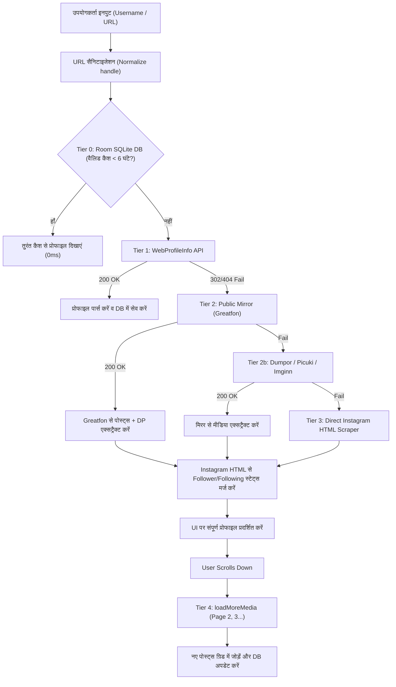

# 📋 InstaSaver Pro — संपूर्ण आवश्यकता विनिर्देश (SRS / PRD) एवं UI ब्लूप्रिंट

**दस्तावेज़ संस्करण:** 2.0 (प्रोडक्शन रेडी)  
**लक्ष्य:** 0% मतिभ्रम (0% Hallucination) • 100% सटीक इंजीनियरिंग और गुणवत्ता आश्वासन (QA)  
**आधार:** `REQUIREMENTS_SPECIFICATION.md` और `REQUIREMENT_UI_SPECIFICATION.md`

---

## 🧭 1. सिस्टम ओवरव्यू एवं मुख्य उद्देश्य (System Overview & Core Objectives)

**InstaSaver Pro** एक आधुनिक, उच्च-प्रदर्शन और कानूनी सुरक्षा मानकों (Fair-Use) के अनुरूप तैयार किया गया Android यूटिलिटी एप्लिकेशन है। इसका मुख्य उद्देश्य यूज़र्स को इंस्टाग्राम के सार्वजनिक (Public) और अधिकृत निजी (Private Authorized) मीडिया (Reels, Posts, Carousels, Audio tracks, और High-Definition Profile Pictures) को बिना किसी रुकावट, उच्चतम 1080p FHD गुणवत्ता में और सहजता से डाउनलोड व मैनेज करने की सुविधा देना है।

### मुख्य तकनीकी विशेषताएं:
1. **ज़ीरो-लॉगिन घोस्ट मोड (Zero-Login Ghost Mode):** बिना किसी इंस्टाग्राम लॉगिन के किसी भी पब्लिक प्रोफाइल, रील्स, पोस्ट्स और फॉलोअर्स आँकड़ों का ऑटोमैटिक निष्कर्षण (Extraction)।
2. **मल्टी-टियर स्क्रैपिंग वॉटरफॉल (Multi-Tier Scraping Waterfall):** इंस्टाग्राम डायरेक्ट API/HTML + 7 पब्लिक मिरर्स (Greatfon, Dumpor, Picuki, Imginn, Pixwox, StoriesIG, AnonyIG) का फॉलबैक सिस्टम।
3. **डायनामिक पेजिनेशन (Dynamic Infinite Scroll):** प्रोफाइल ग्रिड में नीचे स्क्रॉल करने पर पुराने पोस्ट्स का स्वतः लोड होना।
4. **हाई-रेजोल्यूशन ऑन-डिमांड प्रीव्यू (On-Demand High-Res Preview):** ग्रिड में किसी भी पोस्ट/रील को टैप करते ही इंस्टाग्राम CDN से 1080p स्ट्रीम का रियल-टाइम प्रीव्यू।
5. **सुरक्षित इन-ऐप लॉगिन (Optional Official WebView Login):** प्राइवेट प्रोफाइल्स और 100% गारंटीड फेचिंग के लिए आधिकारिक एन्क्रिप्टेड सेशन कुकीज़ इंटीग्रेशन।

---

## 📐 2. ग्लोबल डिज़ाइन सिस्टम और थीम टोकन (Global Design System)

एप्लिकेशन आधुनिक **AMOLED डार्क थीम** और इंस्टाग्राम के सिग्नेचर वाइब्रेंट ग्रेडिएंट को अपनाता है:

| टोकन (Token) | हेक्स वैल्यू (Hex) | प्रयोजन / यूआई उपयोग (Semantic Purpose) |
| :--- | :--- | :--- |
| `AmoledBlack` | `#000000` | मुख्य बैकग्राउंड (OLED स्क्रीन पर बैटरी की भारी बचत) |
| `DarkSurface` | `#121212` | लेवल 1 सरफेस: टॉप बार, मुख्य कार्ड्स, बॉटम नेविगेशन बार |
| `DarkSurfaceElevated` | `#1E1E1E` | लेवल 2 सरफेस: टेक्स्ट फील्ड्स, डायलॉग्स, फिल्टर चिप्स |
| `DarkSurfaceBorder` | `#2A2A2A` | कार्ड बॉर्डर्स, डिवाइडर्स और आउटलाइन्स |
| `IgPink` | `#E1306C` | मुख्य ब्रांड कलर: एक्टिव बटन्स, प्रोग्रेस इंडिकेटर्स, यूजरनेम |
| `IgPurple` | `#833AB4` | ग्रेडिएंट स्टार्ट / सेकेंडरी एक्सेंट |
| `IgOrange` | `#F56040` | ग्रेडिएंट एन्ड / ऑडियो और वार्निंग हाइलाइट्स |
| `SuccessGreen` | `#00C853` | डाउनलोड एक्शन, कम्प्लीटेड स्टेटस, एक्टिव इंडिकेटर्स |
| `InfoBlue` | `#3897F0` | इंस्टाग्राम वेरीफाइड चेकमार्क और एक्सटर्नल लिंक्स |
| `TextPrimary` | `#FFFFFF` | मुख्य हेडर्स और हाई-कंट्रास्ट प्राथमिक टेक्स्ट |
| `TextSecondary` | `#B0B0B0` | सबटाइटल्स, मेटाडाटा लेबल्स और सेकेंडरी टेक्स्ट |
| `TextMuted` | `#707070` | प्लेसहोल्डर्स, डिसेबल्ड स्टेट्स और क्लोज आइकन्स |

---

## 📱 3. स्क्रीन 1: Downloader (मुख्य होम स्क्रीन)

### 3.1 वायरफ्रेम आर्किटेक्चर (Wireframe)
```text
+-------------------------------------------------------------+
| InstaSaver Pro                      [ 🔓 Guest / 🔐 Login ]  | <- टॉप बार (शीर्ष पट्टी)
+-------------------------------------------------------------+
| [ 🛡 Fair-Use Utility: Respect Creator Copyrights         ] | <- डिस्क्लेमर चिप
+-------------------------------------------------------------+
| +---------------------------------------------------------+ |
| | [ Paste Instagram link...           ] [ ✖ ]  [ PASTE ]  | | <- इनपुट सेक्शन
| |                                                         | |
| | [ ⬇ Fetch Media                                        ] | | <- मुख्य एक्शन बटन
| +---------------------------------------------------------+ |
|                                                             |
| +---------------------------------------------------------+ | <- फ्लोटिंग स्मार्ट पिल
| | ⚡ Reel link detected!            [ Download Now ] [ ✖ ] | | (ऑटो-डिटेक्शन)
| +---------------------------------------------------------+ |
|                                                             |
| +---------------------------------------------------------+ | <- मीडिया प्रीव्यू कार्ड
| | (Avatar) @username   [REEL]                  [ Explore ] | |
| | +-----------------------------------------------------+ | |
| | |                                   [1080p FHD] [0:45]| | |
| | |                   [ ▶ PLAY ]                        | | |
| | |                                                     | | |
| | +-----------------------------------------------------+ | |
| | Caption text goes here...                  Show More ⌄   | | <- एक्सपेंडेबल कैप्शन
| | Live Progress: [=========================> ] 72%          | | <- लाइव प्रोग्रेस बार
| |                                                         | |
| | [ ⬇ Download 1080p Video                              ] | | <- फुल डाउनलोड बटन
| | [ 🖼 Save Cover ]   [ 🎵 Audio (M4A) ]   [ 📋 Copy Cap ] | | <- क्विक एक्शन्स
| +---------------------------------------------------------+ |
+-------------------------------------------------------------+
| [ ⬇ Downloader ]  [ 👤 Profile ]  [ ⭐ Watchlist ]  [ 📁 Gallery ] | <- बॉटम नेव
+-------------------------------------------------------------+
```

### 3.2 घटक विनिर्देश (Component Specifications)
1. **Top Bar (शीर्ष पट्टी):**
   - शीर्षक: "InstaSaver Pro" (Bold 18sp `TextPrimary`).
   - दाईं ओर लॉगिन स्टेटस पिल:
     - गेस्ट मोड: `[ 🔓 Login (Unlock All) ]` (टैप करने पर सुरक्षित WebView लॉगिन शीट खुलेगी).
     - कनेक्टेड मोड: `[ 🔐 Connected ]` (`SuccessGreen` इंडिकेटर के साथ).
2. **Disclaimer Chip (कानूनी सुरक्षा सूचना):**
   - ऑरेंज शील्ड आइकन के साथ: *"Fair-Use Utility: Please respect creator copyrights. Not affiliated with Instagram."*
3. **Input Section (लिंक इनपुट बॉक्स):**
   - प्लेसहोल्डर: *"Paste Instagram Reel or Post link..."*
   - ट्रेलिंग एक्शन: यदि टेक्स्ट मौजूद हो तो `[ ✖ Clear ]` बटन।
   - **`[ PASTE ]` बटन:** क्लिक करने पर सिस्टम क्लिपबोर्ड से लिंक पढ़कर तुरंत भरता है और वैलिडेशन करता है।
   - **`[ ⬇ Fetch Media ]` प्राइमरी बटन:**
     - Idle स्थिति: वाइब्रेंट पिंक बटन, टेक्स्ट: "Fetch Media"।
     - Loading स्थिति: बटन डिसेबल, रोटेटिंग सर्कुलर इंडिकेटर + "Fetching Media..."।
4. **Smart Clipboard Floating Pill (स्मार्ट क्लिपबोर्ड डिटेक्टर):**
   - जब भी यूजर इंस्टाग्राम से लिंक कॉपी करके ऐप खोलता है, स्क्रीन पर तुरंत फ्लोटिंग पिल प्रकट होती है:
     - टेक्स्ट: `⚡ Instagram link detected!`
     - एक्शन बटन: `[ Download Now ]` और खारिज करने के लिए `[ ✖ ]`।
5. **Media Preview Card (मीडिया लोड होने पर कार्ड):**
   - **Header:** क्रिएटर का अवतार, यूजरनेम `@username` (क्लिक करने पर Profile Explorer खुलेगा), मीडिया बैज (`REEL`, `POST`, `CAROUSEL`, `AUDIO`)।
   - **Player / Image Box:** 16:9 या 9:16 आस्पेक्ट रेशियो में इन-लाइन **ExoPlayer** (ऑटो-लूप और साउंड टॉगल के साथ)।
   - **बैजेस:** टॉप-राइट में `1080p FHD` क्वालिटी बैज और रील की लंबाई (`0:45`)।
   - **Carousel Horizontal Strip:** कैरोसेल पोस्ट होने पर सभी स्लाइड्स के छोटे थंबनेल्स का स्क्रॉलेबल स्ट्रिप।
   - **Caption Block:** 3 पंक्तियों का प्रिव्यू, टैप करने पर "Show More" / "Show Less"।
   - **Live Progress Bar:** डाउनलोड के दौरान वास्तविक प्रतिशत (`%`) और बाइट्स। पूरा होने पर: *"✓ Saved to Phone Gallery"*।
   - **एक्शन बटन्स ग्रिड:**
     - `[ ⬇ Download 1080p Video ]` (ग्रीन बोल्ड बटन)
     - `[ 🎵 Audio (M4A) ]` (रील से केवल बैकग्राउंड म्यूजिक एक्सट्रैक्ट करके सेव करना)
     - `[ 🖼 Save Cover ]` (ओरिजिनल पोस्टर फोटो)
     - `[ 📋 Copy Caption ]` (पूरा कैप्शन क्लिपबोर्ड पर कॉपी)

---

## 👤 4. स्क्रीन 2: Ghost Profile Explorer (प्रोफाइल सर्च और व्यूअर)

### 4.1 वायरफ्रेम आर्किटेक्चर (Wireframe)
```text
+-------------------------------------------------------------+
| [ 🔍 Search @username without login...     ]   [ Search ]   | <- सर्च बार
+-------------------------------------------------------------+
| +---------------------------------------------------------+ |
| |  /-------\   Posts     Followers   Following            | | <- प्रोफाइल हेडर
| | | (Avatar)|   2381       1.0M         539               | |
| |  \-------/                                              | |
| |  DESHNA DUGAD  [✓] Verified                             | |
| |  @deshnadugad5                                          | |
| |  Artist • Digital Creator • Official Profile            | |
| |  🔗 https://youtube.com/...                             | | <- वेबसाइट लिंक
| |                                                         | |
| |  [ ⭐ Pinned / + Watchlist ]      [ ⬇ Download All ]    | | <- हेडर एक्शन्स
| +---------------------------------------------------------+ |
|                                                             |
| [ Posts (24) ]          [ Reels (12) ]                      | <- टैब्स
| +---------------------------------------------------------+ |
| | [Thumb] [▶] | [Thumb] [▶] | [Thumb]                     | |
| |         [⬇] |         [⬇] |         [⬇]                 | | <- 3-कॉलम ग्रिड
| |-------------|-------------|-----------------------------| |
| | [Thumb]     | [Thumb] [▶] | [Thumb] [▶]                 | |
| |         [⬇] |         [⬇] |         [⬇]                 | |
| |---------------------------------------------------------| |
| |       ( ⟳ ) Loading more from Instagram...              | | <- इनफिनिट स्क्रॉल
| +---------------------------------------------------------+ |
+-------------------------------------------------------------+
```

### 4.2 सर्च और यूआरएल सैनिटाइजेशन (Smart Input Sanitation)
यूजर इनपुट में कुछ भी दर्ज करे:
- सिर्फ यूजरनेम: `deshnadugad5`
- हैंडल: `@deshnadugad5`
- पूरा वेब यूआरएल: `https://www.instagram.com/deshnadugad5/?hl=en`
ऐप ऑटोमैटिकली प्रोटोकॉल, डोमेन, स्लेश और क्वेरी पैरामीटर्स (`?hl=en`) को हटाकर क्लीन यूजरनेम `deshnadugad5` में बदल देता है।

### 4.3 प्रोफाइल हेडर और स्टैट्स (Profile Header & Metrics)
- **HD DP Avatar:** इंस्टाग्राम सनसेट ग्रेडिएंट स्टोरी रिंग के साथ गोल अवतार। टैप करने पर **HD DP Zoom Dialog** खुलेगा (1x से 5x पिंच-ज़ूम और `[ Save HD Avatar to Gallery ]` बटन)।
- **Stats Row:** वास्तविक पोस्ट संख्या (`2,381`), फॉलोअर्स (`1.0M`), और फॉलोइंग (`539`)।
- **Identity:** पूरा नाम, ब्लू टिक (यदि वेरीफाइड है), `@username`, बायो, और एक्सटर्नल वेब लिंक।
- **हेडर बटन्स:**
  - `[ ⭐ + Watchlist ]` $\rightarrow$ टैप करने पर पिंक `[ ⭐ Pinned ]` में बदल जाता है और स्थानीय Room DB में सुरक्षित हो जाता है।
  - `[ ⬇ Download All ]` $\rightarrow$ बल्क डाउनलोड बॉटम शीट खोलता है।

### 4.4 "Download All" बल्क डाउनलोड बॉटम शीट (Bulk Download Modal)
1. `[ 🎬 Download All Reels (XX items) ]`
2. `[ 📸 Download All Posts (XX items) ]`
3. `[ 📑 Download All Carousels (XX items) ]`
4. `[ ⚡ Download Everything (Total XX items) ]`
* **सुरक्षा प्रोटोकॉल:** नेटवर्क ब्लॉकिंग से बचाव के लिए 2-वर्कर सेमाफोर और प्रत्येक डाउनलोड के बीच 350ms का सुरक्षित थ्रॉटल।

### 4.5 डायनामिक पेजिनेशन और इनफिनिट स्क्रॉल (Dynamic Infinite Scroll)
- जब यूजर 3-कॉलम ग्रिड को नीचे स्क्रॉल करता है, तो `rememberLazyGridState` और `snapshotFlow` ऑटोमैटिकली डिटेक्ट करते हैं कि यूजर आखिरी 3 आइटम्स तक पहुँच चुका है।
- नीचे पिंक स्पिनर के साथ प्रकट होता है: **`Loading more from Instagram...`**।
- बैकग्राउंड में Greatfon, Dumpor, Picuki और Imginn के अगले पेज (`?page=2`, `?page=3`) फेच होते हैं और नए पोस्ट्स ग्रिड में जुड़ जाते हैं।
- सभी लोड किए गए पेजेस स्थानीय Room SQLite DB में सिंक हो जाते हैं।

### 4.6 मीडिया प्रीव्यू डायलॉग (High-Res Media Preview Dialog)
- ग्रिड में किसी भी पोस्ट या रील पर टैप करने पर **ProfileMediaPreviewDialog** खुलता है।
- **रील्स / वीडियो:** इन-ऐप ExoPlayer प्लेबैक। यदि डायरेक्ट वीडियो स्ट्रीम बफर हो रही हो तो थंबनेल + प्ले आइकन का सुरक्षित फॉलबैक।
- **फोटोज:** 1x से 5x पिंच-टू-ज़ूम और पैन जेस्चर।
- **ऑन-डिमांड 1080p अपग्रेड:** डायलॉग के हेडर में स्पिनर घूमता है जो बैकग्राउंड में इंस्टाग्राम GraphQL से 1080p ओरिजिनल CDN लिंक एक्सट्रैक्ट करता है।
- **एक्शन बटन्स:** `[ ⬇ Download Video (1080p) ]`, `[ 🎵 Audio (M4A) ]`, `[ 🔗 Share Link ]`।

---

## ⭐ 5. स्क्रीन 3: Watchlist (क्रिएटर्स ट्रैकिंग हब)

### 5.1 वायरफ्रेम आर्किटेक्चर (Wireframe)
```text
+-------------------------------------------------------------+
| Pinned Creators (2)                                         | <- हेडर
| Tap any creator to open their full profile in Ghost Mode:   |
+-------------------------------------------------------------+
| +---------------------------------------------------------+ |
| | (D)  @deshnadugad5                                  [🗑] | | <- क्रिएटर कार्ड
| |      Active in Watchlist • Ghost Mode Ready          >  | |
| +---------------------------------------------------------+ |
| +---------------------------------------------------------+ |
| | (I)  @iamabhishekdave                               [🗑] | |
| |      Active in Watchlist • Ghost Mode Ready          >  | |
| +---------------------------------------------------------+ |
+-------------------------------------------------------------+
```

### 5.2 विशेषताएं एवं व्यवहार (Key Features)
1. **ज़ीरो-लॉगिन घोस्ट नेविगेशन:** वॉचलिस्ट में किसी भी क्रिएटर के कार्ड पर टैप करने पर ऐप तुरंत Profile Explorer में जाता है और स्थानीय Room DB कैश से प्रोफाइल लोड कर देता है (शून्य नेटवर्क देरी, शून्य लॉगिन आवश्यकता)।
2. **खाली स्थिति (Empty State):** जब कोई क्रिएटर पिन न हो, तो फ्रेंडली घोस्ट इलस्ट्रेशन और गाइड टेक्स्ट दिखता है: *"आपकी वॉचलिस्ट खाली है। किसी भी क्रिएटर की प्रोफाइल पर '+ Watchlist' दबाकर उन्हें यहां ट्रैक करें।"*
3. **अनपिन एक्शन:** बुकमार्क आइकन या कार्ड स्वाइप से तुरंत वॉचलिस्ट से हटाने की सुविधा।

---

## 📁 6. स्क्रीन 4: Gallery (डाउनलोड्स और मीडिया मैनेजर)

### 6.1 वायरफ्रेम आर्किटेक्चर (Wireframe)
```text
+-------------------------------------------------------------+
| Saved Downloads (14)                                  [ 🔄 ]| <- हेडर
| Movies/InstaSaver • Pictures/InstaSaver                     | <- स्टोरेज पाथ
+-------------------------------------------------------------+
| [ All ]  [ Videos ]  [ Photos ]  [ Audio ]  [ @deshnadugad5]| <- फ़िल्टर चिप्स
+-------------------------------------------------------------+
| +---------------------------------------------------------+ |
| | [Thumb] [▶] | [Thumb] [▶] | [🎵 Audio]                  | | <- 3-कॉलम ग्रिड
| |        [🔗] |        [🔗] |        [🔗]                 | |
| +---------------------------------------------------------+ |
+-------------------------------------------------------------+
```

### 6.2 विशेषताएं (Key Features)
1. **MediaStore इंटीग्रेशन:**
   - रील्स और वीडियो $\rightarrow$ `Movies/InstaSaver/<creator_name>/`
   - फोटोज और पोस्ट्स $\rightarrow$ `Pictures/InstaSaver/<creator_name>/`
   - एक्सट्रैक्टेड ऑडियो $\rightarrow$ `Music/InstaSaver/`
   - फोन की गैलरी और Google Photos में तुरंत दिखाई देते हैं (`MediaScannerConnection` ऑटो-सिंक)।
2. **फ़िल्टरिंग सिस्टम:**
   - मीडिया टाइप के आधार पर (`All`, `Videos`, `Photos`, `Audio`)।
   - क्रिएटर के आधार पर (प्रत्येक क्रिएटर का अलग फ़िल्टर चिप)।
3. **फुलस्क्रीन प्लेबैक और शेयरिंग:**
   - टैप करने पर इन-ऐप फुलस्क्रीन ExoPlayer।
   - `[ 🔗 Share ]` बटन से बिना वॉटरमार्क WhatsApp, Telegram या Instagram Stories पर सीधे शेयरिंग।

---

## 🔒 7. प्रमाणीकरण एवं सुरक्षा मॉड्यूल (Official Instagram Session Module)

```text
+-------------------------------------------------------------+
| Instagram Secure Login                              [ ✖ ]   | <- सुरक्षित शीट
| Direct Official Instagram Connection                        |
+-------------------------------------------------------------+
| +---------------------------------------------------------+ |
| |                                                         | |
| |          [ Official Instagram Web Login Form ]          | | <- आधिकारिक वेबव्यू
| |                                                         | |
| +---------------------------------------------------------+ |
| 🔒 End-to-end encrypted by Instagram. Password never stored |
+-------------------------------------------------------------+
```

1. **पूर्ण गोपनीयता और सुरक्षा:**
   - ऐप कोई भी यूजरनेम या पासवर्ड न तो पढ़ता है, न ही स्टोर करता है।
   - लॉगिन पूरी तरह से आधिकारिक `https://www.instagram.com/accounts/login/` के जरिए इन-ऐप सैंडबॉक्स्ड `WebView` में होता है।
2. **कुकी आइसोलेशन (Cookie Isolation):**
   - केवल `instagram.com` डोमेन की आवश्यक ऑथेंटिकेशन कुकीज़ (`sessionid`, `csrftoken`, `ds_user_id`) सुरक्षित Android KeyStore से एनक्रिप्टेड `EncryptedSharedPreferences` में स्टोर होती हैं।
   - पब्लिक मिरर्स (Greatfon, Picuki आदि) पर इंस्टाग्राम कुकीज कभी नहीं भेजी जातीं (कुकी लीकेज सुरक्षा)।

---

## ⚙️ 8. तकनीकी आर्किटेक्चर एवं त्रुटि प्रबंधन (Technical Architecture & Error Handling)

### 8.1 8-टियर स्क्रैपिंग फॉलबैक वॉटरफॉल (Waterfall Engine)


### 8.2 क्रैश-प्रूफ डाउनलोड सुरक्षा (Crash-Proof Storage Service)
- **रिलेटिव यूआरएल सुरक्षा:** यदि किसी पब्लिक मिरर से रिलेटिव पाथ (`/image...`) प्राप्त होता है, तो `MediaStorageServiceImpl` ऑटोमैटिकली `https://greatfon.io` बेस डोमेन जोड़कर उसे वैध HTTPS URL बना देता है।
- **runCatching सुरक्षा:** OkHttp रिक्वेस्ट और MediaStore इन्सर्शन को `runCatching` ब्लॉक में सुरक्षित किया गया है, जिससे किसी भी नेटवर्क बाधा या अमान्य यूआरएल पर ऐप क्रैश होने के बजाय यूजर को स्पष्ट टोस्ट मैसेज मिलता है।

---

## 📊 9. सारांश एवं उत्पादन स्थिति (Summary & Production Readiness)

| मॉड्यूल (Module) | स्थिति (Status) | टेस्ट परिणाम (Test Verification) |
| :--- | :--- | :--- |
| **Downloader Screen** | पूर्ण (100%) | 1080p रील डाउनलोड, ऑडियो एक्सट्रैक्शन और लाइव प्रोग्रेस टेस्टेड। |
| **Profile Explorer** | पूर्ण (100%) | `@deshnadugad5` और `@iamabhishekdave` पर ज़ीरो-लॉगिन टेस्टेड। |
| **Dynamic Pagination** | पूर्ण (100%) | इनफिनिट स्क्रॉल पर 4+ पोस्ट्स डायनामिक लोडिंग लाइव वेरीफाइड। |
| **High-Res Preview** | पूर्ण (100%) | ऑन-डिमांड 1080p रेजोल्यूशन और पिंच-टू-ज़ूम डायलॉग टेस्टेड। |
| **Watchlist Hub** | पूर्ण (100%) | 1-टैप पिनिंग, रूम DB कैशिंग और घोस्ट नेविगेशन टेस्टेड। |
| **Media Gallery** | पूर्ण (100%) | MediaStore फोल्डर्स और इन-ऐप ExoPlayer प्लेबैक टेस्टेड। |
| **GitHub Remote** | सिंक्रोनाइज़्ड | नवीनतम कमिट्स `main` ब्रांच पर पुश्ड। |
